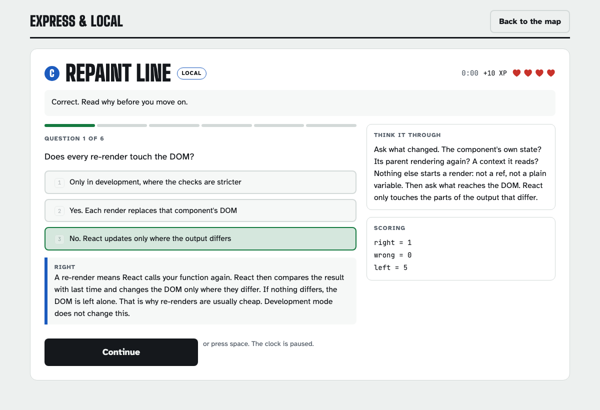
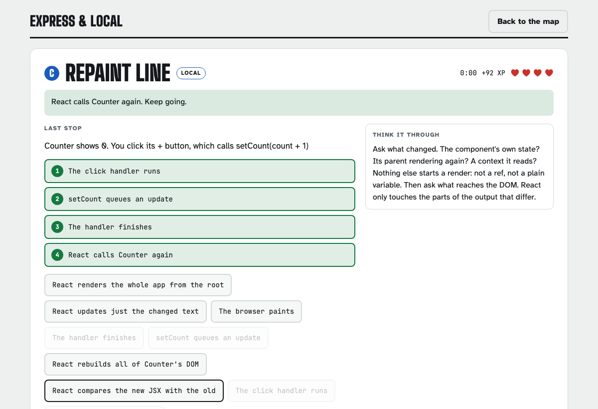
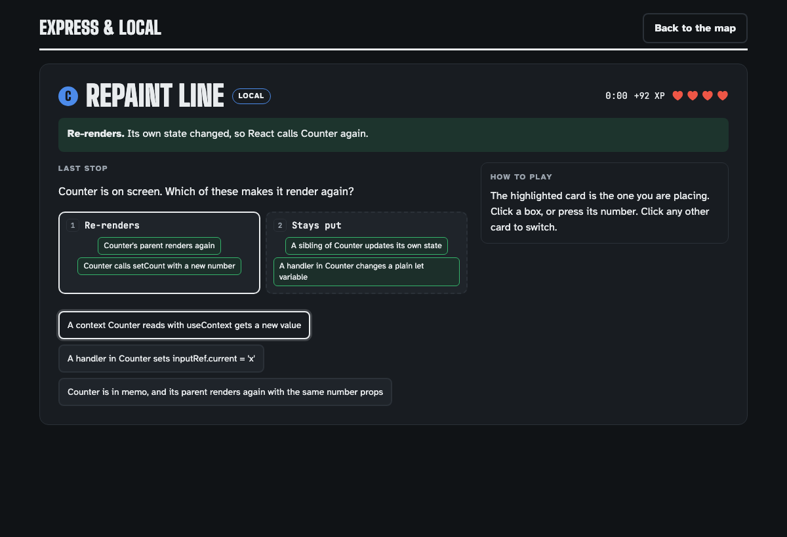
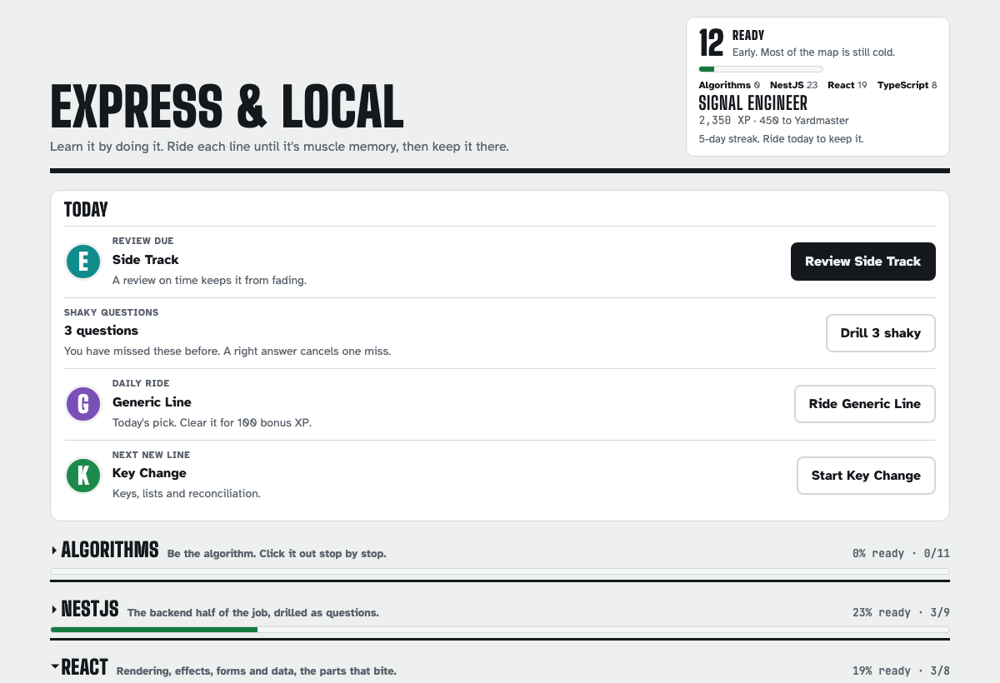
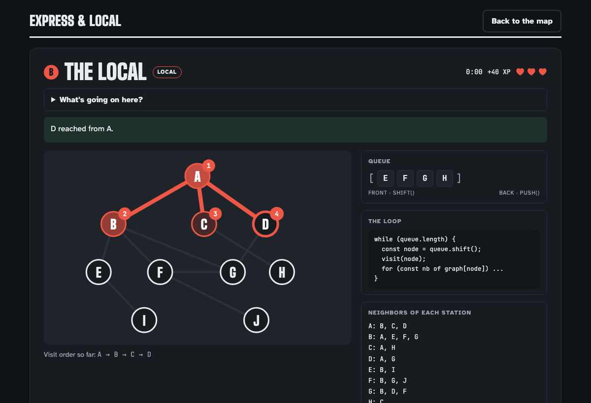
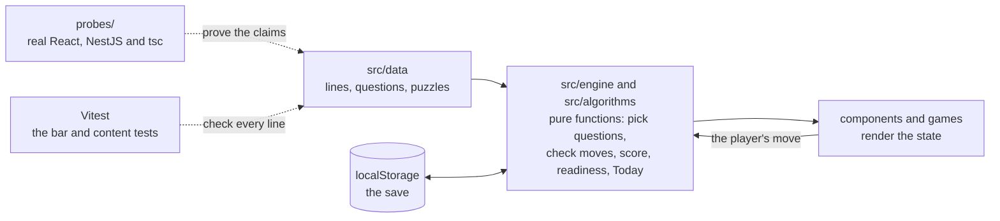

# Express & Local

**Learn it by doing it.** A subway-themed practice app for technical interviews, covering algorithms, NestJS, React and TypeScript. The algorithm lines are interactive: you play BFS by clicking stations in order while the queue fills up beside you. The stack lines drill the way an interview does: a question, a committed answer and the reasoning behind it, a puzzle that has to be worked out rather than recognized, and an out-loud round so the answer has been spoken before anyone asks for it.


## What it covers

34 lines across four divisions. Each division unlocks in its own order, so NestJS can be started without finishing every sorting line.

### Algorithms

Hand-built games. You play the algorithm step by step.

|       | Line               | Topic                |
| ----- | ------------------ | -------------------- |
| **Q** | Push & Pop Shuttle | Stacks and queues    |
| **B** | The Local          | Breadth-first search |
| **D** | The Express        | Depth-first search   |
| **S** | Split Line         | Binary search        |
| **W** | Swap Yard          | Bubble sort          |
| **R** | Call Stack Line    | Recursion            |
| **H** | Coat Check         | Hash tables          |
| **M** | Merge Junction     | Merge sort           |
| **P** | Pivot Point        | Quicksort            |
| **2** | Both Ends          | Two pointers         |
| **J** | Shortest Route     | Dijkstra             |

### NestJS

Checked against the NestJS 12 documentation, then reviewed claim by claim against running Nest 12.1.3 code. Where a behavior depends on the version or the HTTP adapter, the content says which.

|       | Line           | Topic                                                                                    |
| ----- | -------------- | ---------------------------------------------------------------------------------------- |
| **1** | Main Line      | The request lifecycle, in order                                                          |
| **2** | Wiring Yard    | DI, modules, dynamic modules, lifecycle hooks, "Nest can't resolve dependencies"         |
| **3** | Platform Signs | Controllers, routing, params, status codes                                               |
| **4** | Ticket Check   | DTOs, ValidationPipe, and schema-first validation                                        |
| **5** | Dispatch Desk  | Guard vs pipe vs interceptor vs filter vs middleware                                     |
| **6** | Fault Line     | Exceptions, status codes, filters                                                        |
| **7** | Tool Shed      | What you implement: canActivate, transform, intercept, catch, use, and custom decorators |
| **8** | Turnstile      | Auth: tokens, guards, req.user, @Public(), 401 vs 403                                    |
| **9** | Test Track     | Testing modules, overrideProvider, unit vs e2e                                           |

### React

Every claim is run against React 19.3 in a test sandbox: real components, rendered with `react-dom`, with renders counted and DOM changes watched.

|       | Line           | Topic                                        |
| ----- | -------------- | -------------------------------------------- |
| **C** | Repaint Line   | What actually triggers a re-render           |
| **E** | Side Track     | Effects, dependencies, cleanup               |
| **A** | Snapshot Line  | State, batching, the updater form            |
| **K** | Key Change     | Keys, lists, reconciliation                  |
| **F** | Memo Yard      | memo, useMemo, useCallback, profiling        |
| **N** | Hook Junction  | Hook rules and the React 19 APIs             |
| **V** | Fare Machine   | Forms, inputs and Actions                    |
| **L** | Arrivals Board | Fetching data, Suspense and error boundaries |

### TypeScript

Every claim is proven with the compiler, with `strict` on, under TypeScript 5.9, 6.0 and 7.0 and `@types/react` 19.3.

|       | Line              | Topic                                         |
| ----- | ----------------- | --------------------------------------------- |
| **T** | Narrow Gauge      | Narrowing, guards, discriminated unions       |
| **G** | Generic Line      | Generics, constraints, inference              |
| **U** | Utility Yard      | Partial, Pick, Omit, Record, ReturnType       |
| **X** | Unknown Territory | any vs unknown, assertions, satisfies, strict |
| **Y** | Shape Yard        | Structural typing, interfaces vs types        |
| **Z** | Typed Components  | Props, events, refs and hooks in React        |

## How a ride works

- **Three tiers per line.** Local, Express and Rush Hour ask up to 6, 8 and 10 questions. Rush Hour turns the helper panels off and adds a par time.
- **Most runs end on a puzzle.** After the questions comes a "last stop": a sort (put each card in the right box) or a flow (put the steps of a process in order). Cards are named by what they do, never by their answer, and flows include decoy steps that do not happen in that scenario. Runs that end on a puzzle get a fourth heart. Every NestJS, TypeScript and React line has puzzles.
- **Replays differ.** Questions not yet seen, or missed last time, come first, and the last-stop puzzle rotates from ride to ride. Every finished line has at least half again as many questions as a run at each tier, and two puzzles to rotate between on Local.
- **A miss says it was a miss, nothing more.** The explanation comes after the answer is committed, and in puzzles at the end of the run. On Local, a second miss on the same step reveals it, so nobody gets stuck.
- **You advance, not a timer.** Explanations stay on screen until you continue, and the clock holds while you read. Number keys pick an option or a box, and space continues.






## Staying sharp



- **A Today band.** The top of the page says what to do right now, most urgent first: a review that is due, the shaky questions, the daily ride, then the next line not yet cleared. Below it, each division is a collapsed header with its readiness bar, and only the division in play is open.
- **Readiness.** The headline number is a 0 to 100 score per division, built from what has been cleared, at which tier, how far along its review schedule, and how much of the question pool is solid. It falls on its own as reviews go overdue, so it reflects what would come back today rather than what was done once.
- **Spaced repetition.** Clearing a line schedules a review at 1, 3, 7, 14, then 30 days, using a Leitner box. An on-time review with at most one mistake grows the gap; a rougher one shrinks it.
- **Shaky questions come back.** Every question is tracked. Missed ones are flagged, weighted into cram drills, and drillable on their own.
- **Say it out loud.** Every stack line has rehearsal prompts: answer in full sentences, then compare against a model answer. Anything marked shaky is asked first next time.
- **Cram drill.** Twelve mixed questions from every opened line, five hearts, filterable by division.
- **Field guide on every line.** Plain-English explanation, vocabulary, real code, talking points, and the common mistake.
- **XP, ranks, streaks, a daily ride, badges and personal bests.** XP is a lifetime total with ten ranks. Derailing costs 50 XP but never drops a rank, and work on a weak line pays a bonus.



## Design decisions

A few choices that shape how the app teaches. [docs/ROADMAP.md](docs/ROADMAP.md) has the full list of principles and how each was arrived at.

- **Readiness over XP.** A total that only goes up measures time spent, and it topped out after a fraction of the content. Readiness is a state that can drop, which is what makes it useful the week before an interview.
- **Never answer the question for the player.** Naming the correct step after a wrong click turned the most useful moment in a puzzle into reading, and made a wrong click the cheapest hint in the app.
- **Measure the content, not just the code.** An audit found the correct answer was the longest option in 83% of questions, so "pick the longest" beat knowing the material. Fixing that by padding the wrong answers made the middle-length option right more than half the time instead. The bar now checks every length position on every line, sort cards cannot be named after their own box, and the study notes stay off the play screen.
- **NestJS and React claims are proven by running them.** NestJS 12 changed defaults and added options after the first lines were written, and the docs do not always match what the code does. Every claim, including why each wrong option is wrong, is run as a small Nest 12.1.3 app. React claims get the same treatment in a React 19.3 sandbox, which caught things like an effect loop React only warns about instead of stopping. Claims that depend on a version or an adapter say so.
- **TypeScript claims are proven with the compiler.** Every example and explanation on a TypeScript line is written out as code and run through `tsc` with assertions that can fail, under TypeScript 5.9, 6.0 and 7.0. It has caught real errors, like a wrong answer that actually narrowed correctly, and an empty `new Map()` turning out to be `Map<any, any>`.
- **Clear beats clever.** One idea per sentence, the example before the name for it, and every term defined the first time it matters. Every explanation says why the right answer is right and why the tempting wrong one is wrong. All three stack divisions are written to it.

## Engineering



- **React 19, TypeScript and Vite.** No backend. Progress is saved in `localStorage`, with a copy-and-paste save code for moving between browsers.
- **Game logic is pure.** Algorithms are small state machines in `src/algorithms/`: the UI asks for the right move, sends the player's move, and renders the state that comes back. Components never decide what is correct.
- **Content is data.** Quiz lines, flows and sorts are entries in `src/data/`, so adding a topic means writing questions, not components.
- **Scoring is pure.** `finishTrip()`, `finishCram()`, `finishRehearsal()` and `finishDerail()` take a save and a run and return a new save plus everything the results screen shows. Readiness is computed from the save, never stored.
- **A quality bar the test suite enforces.** `src/data/bar.ts` checks every line: a full run at every tier with room to vary, two puzzles on Local, three rehearsal prompts, talking points and a gotcha in its field guide, and answers that are not guessable by length. `npm run bar` prints where each division stands. Divisions listed as finished (NestJS, TypeScript and React) fail the tests if any line slips.
- **Tested with Vitest.** The tests play each algorithm perfectly and compare against a reference, cover progression (readiness, review scheduling, streaks, tiers, badges, derail costs, save migration and repair of damaged saves), validate every piece of content, and render the results screen for every line. One Playwright test rides a line twice on Local against the production build, checks Back and Forward mid-ride, then opens the line by its URL in a fresh browser and moves the save code there.
- **Checked on every push.** GitHub Actions runs the format check, lint, typecheck, every test, the TypeScript probes, a production build and the end-to-end test on each push and pull request.
- **A small router of its own.** Every line has a URL, like `/nest/life`, and the browser's Back button leaves a ride for its line instead of leaving the app. It is about a hundred lines on the History API, with the path parsing as pure, tested functions, rather than a routing library for five URLs.
- **Accessible, and tested for it.** Keyboard shortcuts, focusable graph nodes and code blocks, `aria-live` status updates, reduced-motion support, and light and dark themes. The end-to-end test runs axe on every screen it passes through, at phone width in light mode and at desktop width in dark mode. A unit test checks every text color in the stylesheet against WCAG AA contrast in both themes.

```
src/
  algorithms/   pure algorithm logic (state machines) and tests
  engine/       save data, progression, scoring, readiness, question pools, and tests
  data/         content per division, the quality bar, and content tests
  games/        one component per algorithm line, plus QuizGame, FlowGame, SortGame and QuizRun
  components/   screens: header, map, intro, play, results, rehearsal, Today band, cram band, badges
  hooks/        useKeys, useTimers, useUrl
  lib/          small helpers
e2e/            one Playwright test that rides a line against the production build, and the README's screenshots
probes/         sandboxes that prove the content against real React, NestJS and TypeScript
docs/           roadmap, architecture, development guide, and decision records
```

## Running locally

Requires Node.js 22.12+.

```bash
npm install
npm run dev        # http://localhost:5173
npm test           # unit and content tests
npm run lint       # ESLint
npm run format     # Prettier
npm run bar        # where each line stands against the quality bar
npm run build      # typecheck and production build into dist/
npm run e2e        # build, then ride a line in Chromium (run `npx playwright install chromium` once)
npm run screenshots  # retake the README's screenshots and GIF (needs ffmpeg)
```

## Adding a line

1. Add the id to the division's id type in `src/engine/types.ts`.
2. Add the line and its field guide entry to the division's data file in `src/data/` (`lines.ts` and `guide.ts`, `nest.ts`, `react.ts` or `typescript.ts`).
3. Give it at least 9 / 12 / 15 questions available on Local / Express / Rush Hour, two Local puzzles (flows or sorts), and three rehearsal prompts.
4. Write to the clarity standard in [CLAUDE.md](CLAUDE.md), and prove every claim with the sandboxes in `probes/`: the compiler for TypeScript, running code for NestJS and React.
5. Run `npm test` and `npm run bar`. A line in a finished division has to clear the bar before the tests pass.
6. A `kind: 'game'` line also needs pure logic with tests in `src/algorithms/` and a component registered in `src/games/index.ts`.

A new division also needs an entry in `DIVISIONS` in `src/engine/questions.ts`.

[docs/ARCHITECTURE.md](docs/ARCHITECTURE.md) covers the content shapes and how to add a question, puzzle, line or division. [docs/DEVELOPMENT.md](docs/DEVELOPMENT.md) covers setup and how content gets checked.

## Roadmap

NestJS, TypeScript and React are finished, gaps included. 1.0 is a short list at the top of [docs/ROADMAP.md](docs/ROADMAP.md). What is left is a live deploy behind CI and a case study. A NestJS and Postgres backend is 2.0.

- [x] **NestJS:** nine lines, all clearing the bar, enforced by the test suite, and independently reviewed
- [x] **Matching puzzles:** sort jobs and signatures into the building block that handles them
- [x] **TypeScript:** six lines clearing the bar, every claim checked with the compiler, and independently reviewed
- [x] **React:** eight lines clearing the bar, every claim run against React 19.3, and independently reviewed
- [x] **Foundation:** formatting and lint, CI on every push, and an end-to-end test
- [x] **No repeats:** questions that tested the same fact as another were given new angles
- [x] **Reorganize the page:** a Today band, a play mode that takes over the screen, real URLs, and accessibility checks as tests
- [x] **README:** a fresh GIF and screenshots, retaken by a script, and an architecture diagram
- [ ] **Ship 1.0:** a live deploy, a case study, and a `v1.0` tag

## How this was built

Designed by Ryan Walker, who set the direction and made the calls recorded in [docs/adr/](docs/adr/). [Claude](https://claude.ai) wrote most of the code and content as a pair programmer, under the rules in [CLAUDE.md](CLAUDE.md): every content claim proven against running code in `probes/`, every wrong option proven wrong, and an independent review before a division counts as finished. Ryan reviewed every commit before pushing it.

Commits up to `c1e7326` carry a Claude co-author trailer. Later ones do not, because the disclosure lives here instead ([ADR 0012](docs/adr/0012-disclose-ai-in-the-readme.md)).

## License

[MIT](LICENSE).
