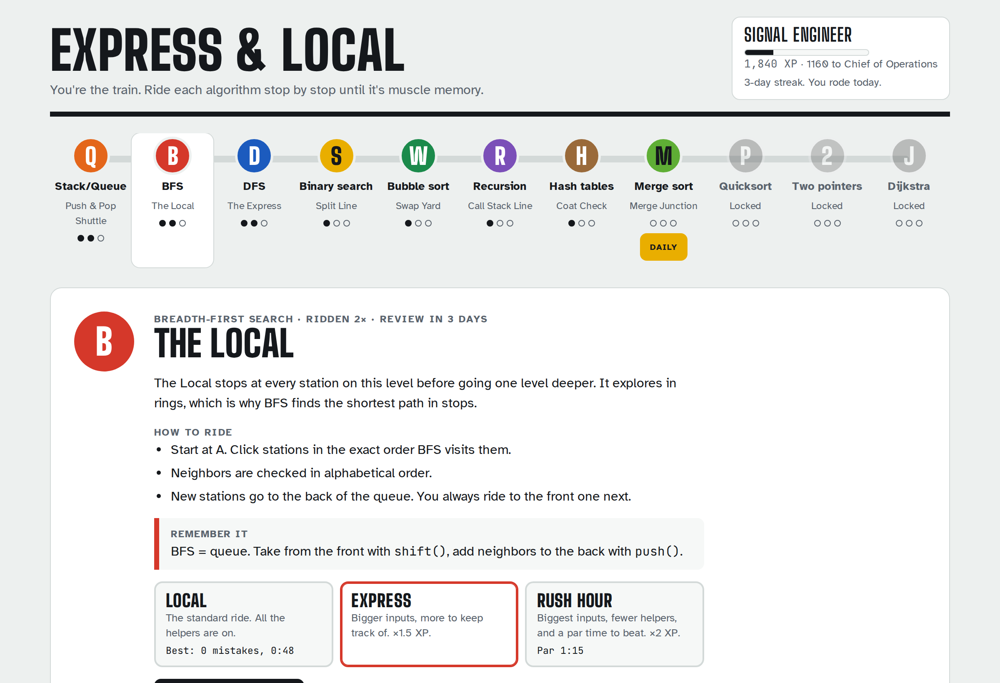

# Express & Local

**Learn algorithms by being the algorithm.** A subway-themed game where you don't watch BFS run. You *are* BFS, clicking stations in order while the queue fills up next to you.



## Why this exists

I spent months trying to make CS fundamentals stick. Videos, articles, flashcards: I'd understand something on Tuesday and forget it by Friday. What finally worked was doing the algorithm by hand, step by step, until the moves were muscle memory. So I built a game around that, and then kept going until I actually wanted to open it every day.

## What you play

Eleven lines, each one an algorithm or data structure. Clear a line to open the next.

| | Line | Topic | You play it by... |
|---|---|---|---|
| **Q** | Push & Pop Shuttle | Stacks and queues | Reading a push/pop log and picking what comes out |
| **B** | The Local | Breadth-first search | Clicking stations in BFS order while the queue updates |
| **D** | The Express | Depth-first search | Same map, but with a stack (and stale entries to skip) |
| **S** | Split Line | Binary search | Clicking the exact `mid` index each step |
| **W** | Swap Yard | Bubble sort | Swap or keep, pair by pair |
| **R** | Call Stack Line | Recursion | Driving the call stack: call, or return a value |
| **H** | Coat Check | Hash tables | Hashing keys into buckets, then looking them up |
| **M** | Merge Junction | Merge sort | Always taking the smaller of two fronts |
| **P** | Pivot Point | Quicksort | Partitioning around a pivot, one value at a time |
| **2** | Both Ends | Two pointers | Walking `lo` and `hi` inward to hit a target sum |
| **J** | Shortest Route | Dijkstra | Settling the closest station, then relaxing edges |


Every ride ends with a fill-in-the-blank code check, so the thing you just did by hand connects back to real code.

## Why it keeps pulling you back

- **Three tiers per line.** Local, Express, and Rush Hour. Inputs get bigger, and Rush Hour takes the helpers away (no queue panel, no distance table) and adds a par time. Your skill grows with the game.
- **Spaced repetition.** Each cleared line schedules a review (1, 3, 7, 14, then 30 days) using a Leitner box system. Nail a review and the gap grows. Stumble and it shrinks.
- **Streaks, a Daily Ride, and 14 badges.** Small, honest incentives to come back tomorrow.
- **A field guide for every line.** Plain-English explanation, vocabulary, where it shows up in real code (React, `Map`, `git bisect`), famous problems to try next, and a bit of history.
- **Personal bests** per line and tier: fewest mistakes, then fastest time.


## Tech

- **React 19 + TypeScript + Vite.** No backend. Progress lives in `localStorage`, with a copy/paste save code for moving between browsers.
- **Game logic is pure.** Every algorithm is a small state machine in `src/algorithms/`: the UI asks for the right move, sends the player's move, and renders whatever state comes back. React never decides what's correct.
- **Scoring is pure too.** `finishTrip()` takes a save and a ride outcome and returns a new save plus everything the results screen shows. No side effects, easy to test.
- **Tested with Vitest.** The tests play each algorithm perfectly and check the result against a reference (sorted output, true shortest distances, correct traversal orders), and cover streaks, tiers, review scheduling, badges, and save migration.
- **Accessible by default.** Keyboard shortcuts on every line, focusable graph nodes, `aria-live` status updates, reduced-motion support, and light/dark themes.
- **Self-hosted fonts** via Fontsource: Big Shoulders Display, Atkinson Hyperlegible, and JetBrains Mono.

```
src/
  algorithms/   pure game logic + tests (graph, sorting, searching, recursion, dijkstra)
  engine/       save data, progression, scoring, badges + tests
  data/         line definitions and field guide copy
  games/        one React component per line
  components/   screens: map, intro, play, quiz, results, badges
```

## Run it

Needs Node 20.19 or newer.

```bash
npm install
npm run dev        # http://localhost:5173
npm test           # unit tests
npm run build      # typecheck + production build into dist/
```

## Deploy

It's a static site. On Vercel: import the repo, keep the Vite preset, deploy. Any static host works (`npm run build`, then serve `dist/`).

## Adding a line

1. Add the line to `LINES` in `src/data/lines.ts` (copy, rules, quiz questions, par time).
2. Add its field guide to `src/data/guide.ts`.
3. Write the logic as pure functions in `src/algorithms/` with a test.
4. Build the game component in `src/games/` and register it in `src/games/index.ts`.

## Roadmap

- [ ] **Event Loop line:** sort callbacks into the call stack, microtask queue, and task queue, then predict the log order
- [ ] **React Re-render line:** a parent's state changes; click every component that re-renders
- [ ] **Engineer's Cab:** after Rush Hour, write the algorithm yourself against in-browser tests
- [ ] **Dispatch Desk:** read a real-world scenario, pick the right algorithm
- [ ] More lines: LRU cache, heaps, linked lists, DP tables, sliding window, SQL joins, Git as a train yard
- [ ] Cross-device progress sync

## Credits

Designed by Ryan Walker. Built with [Claude](https://claude.ai) as a pair programmer.
