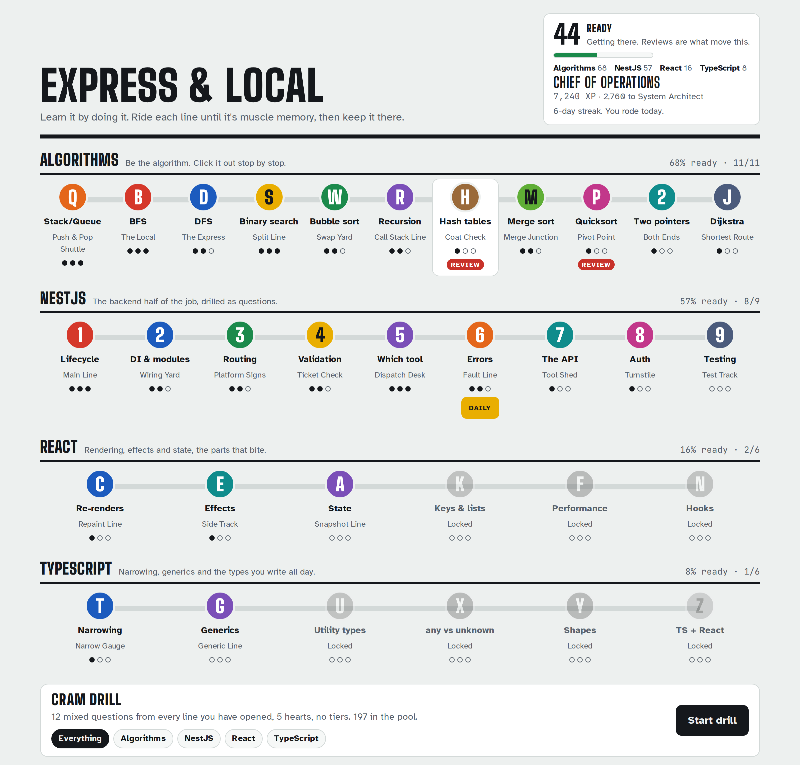
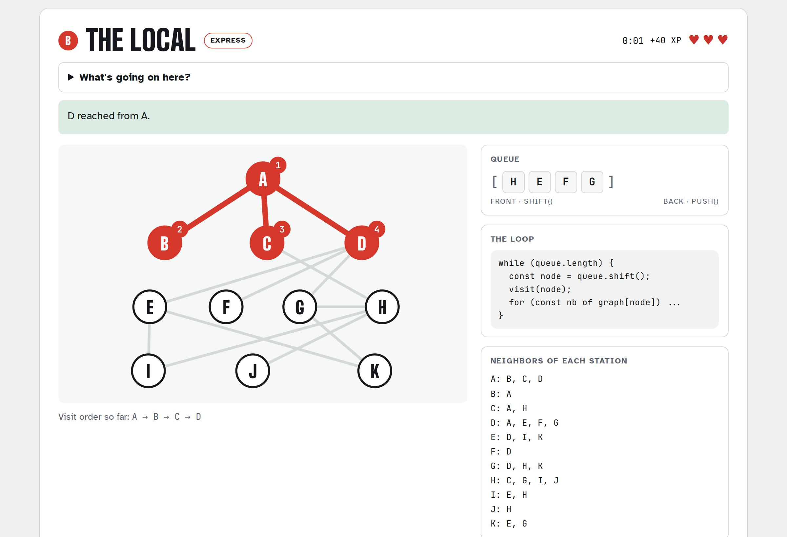
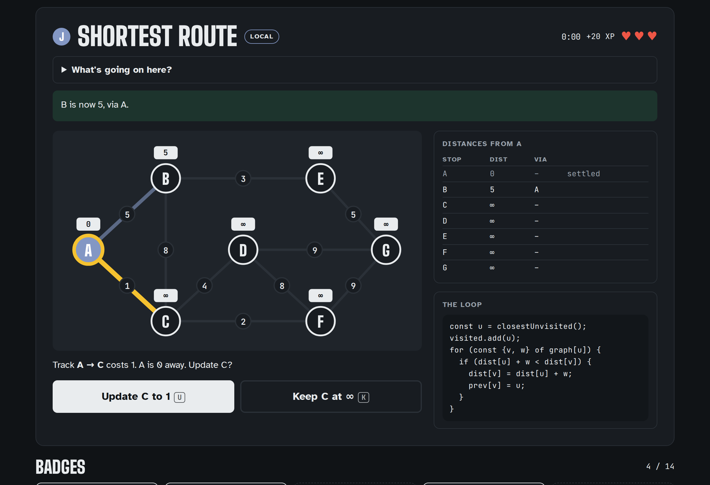

# Express & Local

**Learn it by doing it.** A subway-themed drill for the things I keep having to re-learn: algorithms, NestJS, React and TypeScript. You don't read about BFS here, you *are* BFS, clicking stations in order while the queue fills up next to you. Then the stack lines drill the same way a real interview does, one question at a time, with the reason spelled out when you miss, and an out-loud round so you have said the answer before someone asks for it.



## Why this exists

I spent months trying to make this stuff stick. Videos, articles, flashcards: I'd understand something on Tuesday and forget it by Friday. What finally worked was doing the thing by hand, over and over, until the moves were muscle memory. So I built a game around that, and then kept adding the parts of my actual job I wanted to be sharper on.

## The map

Lines are grouped into divisions. Each division unlocks in its own order, so you can start NestJS without finishing every sorting line.

### Algorithms (lettered lines)

Hand-built games. You play the algorithm step by step.

| | Line | Topic |
|---|---|---|
| **Q** | Push & Pop Shuttle | Stacks and queues |
| **B** | The Local | Breadth-first search |
| **D** | The Express | Depth-first search |
| **S** | Split Line | Binary search |
| **W** | Swap Yard | Bubble sort |
| **R** | Call Stack Line | Recursion |
| **H** | Coat Check | Hash tables |
| **M** | Merge Junction | Merge sort |
| **P** | Pivot Point | Quicksort |
| **2** | Both Ends | Two pointers |
| **J** | Shortest Route | Dijkstra |

### NestJS (numbered lines)

| | Line | Topic |
|---|---|---|
| **1** | Main Line | Put the request lifecycle in order |
| **2** | Wiring Yard | DI, modules, "Nest can't resolve dependencies" |
| **3** | Platform Signs | Controllers, routing, params, status codes |
| **4** | Ticket Check | DTOs and the ValidationPipe |
| **5** | Dispatch Desk | Guard vs pipe vs interceptor vs filter vs middleware |
| **6** | Fault Line | Exceptions, status codes, filters |

### React

| | Line | Topic |
|---|---|---|
| **C** | Repaint Line | What actually triggers a re-render |
| **E** | Side Track | Effects, dependencies, cleanup |
| **A** | Snapshot Line | State, batching, the updater form |
| **K** | Key Change | Keys, lists, reconciliation |
| **F** | Memo Yard | memo, useMemo, useCallback, profiling |
| **N** | Hook Junction | Hook rules and the React 19 APIs |

### TypeScript

| | Line | Topic |
|---|---|---|
| **T** | Narrow Gauge | Narrowing, guards, discriminated unions |
| **G** | Generic Line | Generics, constraints, inference |
| **U** | Utility Yard | Partial, Pick, Omit, Record, ReturnType |
| **X** | Unknown Territory | any vs unknown, assertions, satisfies, strict |
| **Y** | Shape Yard | Structural typing, interfaces vs types |
| **Z** | Typed Components | Props, events, refs and hooks in React |

## What keeps you coming back

- **Three tiers per line.** Local, Express, Rush Hour. Inputs get bigger, question pools get deeper, and Rush Hour takes the helpers away and adds a par time.
- **Spaced repetition.** Clearing a line schedules a review (1, 3, 7, 14, then 30 days) with a Leitner box. Nail the review and the gap grows, stumble and it shrinks.
- **Cram drill.** Twelve mixed questions from everything you have opened, five hearts, no tiers, filterable by division. Built for the morning of an interview.
- **Weak spots come back.** Every question is tracked by id, so the ones you have missed are flagged as shaky, weighted into cram drills, and drillable on their own from the line or the map.
- **Say it out loud.** The stack lines have rehearsal prompts: answer in full sentences, then check yourself against the model answer. Anything you call shaky is asked first next time. Reading an answer and saying one are different skills, and interviews test the second.
- **A field guide on every line.** Plain English, vocabulary, real code, and for the stack lines, the talking points to say out loud plus the gotcha people trip on.
- **Streaks, a daily ride, badges and personal bests.**




## Tech

- **React 19 + TypeScript + Vite.** No backend. Progress lives in `localStorage`, with a copy/paste save code for moving between browsers.
- **Game logic is pure.** Algorithms are small state machines in `src/algorithms/`: the UI asks what the right move is, sends the player's move, and renders whatever state comes back. React never decides what's correct.
- **Content is data.** Quiz and flow lines are entries in `src/data/`, so adding a topic is writing questions, not writing components.
- **Scoring is pure too.** `finishTrip()` and `finishCram()` take a save plus a run and return a new save with everything the results screen shows.
- **Tested with Vitest.** The tests play each algorithm perfectly and check the result against a reference, cover progression (streaks, tiers, review scheduling, badges, save migration), validate the content (every answer exists among its options, no em dashes in player-facing copy), and server-render the results screens for every line.
- **Accessible by default.** Keyboard shortcuts, focusable graph nodes, `aria-live` status updates, reduced motion, light and dark themes.

```
src/
  algorithms/   pure algorithm logic + tests
  engine/       save data, progression, scoring, question pools + tests
  data/         lines.ts + guide.ts (algorithms), nest.ts, react.ts, index.ts
  games/        one component per algorithm line, plus QuizGame and FlowGame
  components/   screens: map, intro, play, quiz, results, cram band, badges
```

## Run it

Needs Node 20.19 or newer.

```bash
npm install
npm run dev        # http://localhost:5173
npm test           # unit tests
npm run build      # typecheck + production build into dist/
```

## Adding a line

1. Add the id to `LineId` in `src/engine/types.ts`.
2. Add the line to its division's data file (`src/data/nest.ts`, `react.ts`, `typescript.ts`, or `lines.ts`) with `division`, `kind`, copy and content.
3. Add its field guide entry in the same file.
4. For a `kind: 'game'` line, write the pure logic in `src/algorithms/` with tests and register the component in `src/games/index.ts`. Quiz and flow lines need no component.

Adding a whole division is the same, plus an entry in `DIVISIONS` in `src/engine/questions.ts`.

## Roadmap

- [x] **TypeScript division:** narrowing, generics, utility types, `unknown` vs `any`, `satisfies`
- [ ] **Engineer's Cab:** after Rush Hour, write the algorithm yourself against in-browser tests
- [ ] **Scenario mode:** read a real-world situation, pick the right algorithm or the right Nest building block
- [ ] More lines: LRU cache, heaps, linked lists, SQL joins, Git as a train yard
- [ ] Cross-device progress sync

## Credits

Designed by Ryan Walker. Built with [Claude](https://claude.ai) as a pair programmer.
